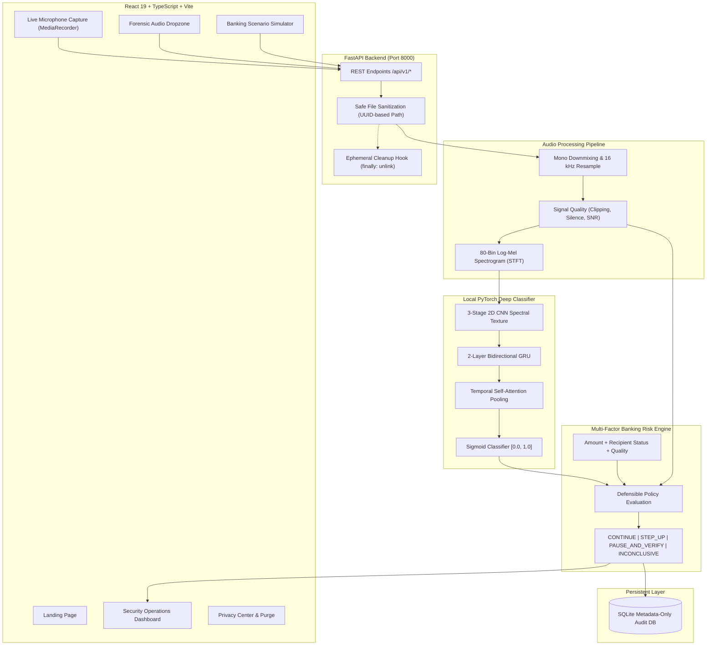
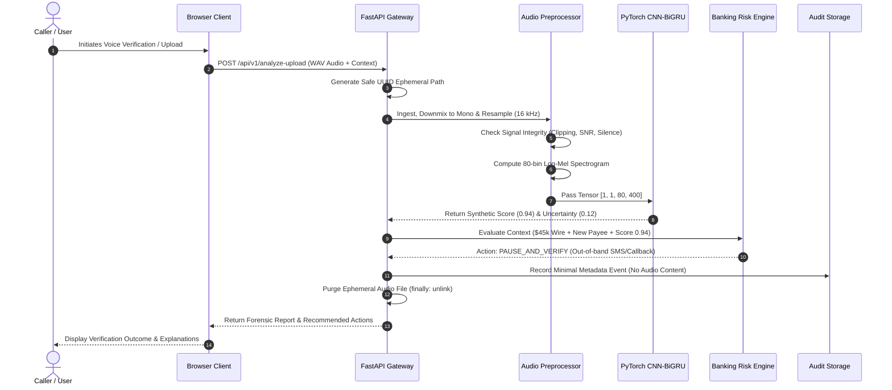

# VoiceShield AI — Enterprise Synthetic Voice Fraud Detection Platform

[](https://opensource.org/licenses/MIT)
[](https://www.python.org/)
[](https://fastapi.tiangolo.com/)
[](https://pytorch.org/)
[](https://react.dev/)
[](https://uditdev0523.github.io/voice-shield-ai/)
[](#24-privacy-architecture-and-retention-behavior)

**Live Demo (Public HTTPS):** [https://uditdev0523.github.io/voice-shield-ai/](https://uditdev0523.github.io/voice-shield-ai/)  
**GitHub Repository:** [https://github.com/uditdev0523/voice-shield-ai](https://github.com/uditdev0523/voice-shield-ai)

---

## 1. Project Introduction

**VoiceShield AI** is an original, end-to-end, human-centered synthetic voice anti-spoofing and financial fraud mitigation platform designed specifically for simulated banking, payment authorization, and identity verification workflows.

The system combines a local PyTorch deep neural network (3-stage 2D CNN + 2-layer Bidirectional GRU with temporal self-attention) running directly inside a FastAPI backend with a contextual multi-factor banking risk decision engine and an interactive React/TypeScript security operations dashboard.

VoiceShield AI operates under a strict **Zero-Audio-Retention** privacy-by-design policy: customer voice recordings are held only in transient client/server memory, strictly purged immediately after inference, and never used for model training or stored on persistent media.

---

## 2. Problem Statement

Advancements in neural voice cloning and text-to-speech synthesis (e.g. VALL-E, Bark, ElevenLabs, XTTS) allow malicious actors to clone human voices using only a 3-second reference audio sample. In banking and call-center environments, attackers use cloned voices for:
- **Executive Impersonation (CEO Wire Fraud):** Authorizing fraudulent corporate wire transfers.
- **Urgent Family Distress Scams:** Coercing peer-to-peer funds transfer to fake accounts.
- **Account Takeover:** Bypassing telephone customer service voice authentication.

Traditional systems either rely on expensive, latency-heavy external cloud APIs that compromise customer privacy, or naive threshold classifiers that lead to false-positive customer account freezes.

---

## 3. Project Objectives

1. **Complete Local Inference:** Eliminate dependencies on external AI APIs (OpenAI, Gemini, paid speech APIs) by deploying a locally served PyTorch model.
2. **Defensible Banking Decision Logic:** Combine acoustic voice scores with transaction amount, payee relationship, and signal quality to determine fair, non-punitive mitigation steps (e.g., out-of-band SMS or callback challenges).
3. **Provable Audio Privacy:** Guarantee zero raw audio retention by default with automated ephemeral buffer cleanup and metadata-only forensic audit logging.
4. **Empirical Benchmarks:** Provide fully reproducible training, evaluation, and robustness testing pipelines on held-out reference partitions without fabricated metrics.
5. **Production Readiness:** Deliver an enterprise-grade UI, automated automated test coverage (API, unit, privacy, risk), Docker orchestration, and public HTTPS deployment readiness.

---

## 4. Key Features

- **Local Deep Anti-Spoofing:** PyTorch CNN + Bi-GRU + Self-Attention evaluating 80-bin Log-Mel Spectrogram features.
- **Signal Quality Verification:** Automated pre-inference screening for clipping harmonic distortion, near silence, and low Signal-to-Noise Ratio (SNR).
- **Multi-Factor Banking Decision Engine:** Contextual policy mapping for transactions, preventing arbitrary account freezes and mandating out-of-band verification.
- **Live Microphone Recording:** Web Audio and MediaRecorder integration capturing audio on-demand with zero automatic page-load access.
- **Forensic Audio Upload:** Drag-and-drop ingestion supporting WAV, MP3, OGG, and FLAC with immediate ephemeral cleanup.
- **Interactive Threat Simulator:** 5 preset realistic scenarios (CEO wire fraud, family distress, routine utility, noisy terminal, high-value deposit) with real-time policy evaluation.
- **Forensic History & CSV Export:** Paginated SQLite metadata audit log with search, filters, and streaming CSV export.
- **Real-Time Privacy Center:** Direct telemetry reflecting active ephemeral files and an immediate memory purge control.
- **Model Robustness Lab:** Empirical held-out test metrics (Precision, Recall, F1, ROC-AUC, EER, Latency) and noise stress benchmarks.

---

## 5. Architecture Diagram



---

## 6. End-to-End Request & Decision Flow



---

## 7. Technology Stack

### Frontend
- **Framework:** React 19 + TypeScript + Vite
- **Styling:** Vanilla CSS design system with custom CSS variables, glassmorphic cards, and accessible typography
- **Navigation:** React Router DOM (v7)
- **Icons:** Lucide React
- **Data Visualization:** Recharts
- **Audio Capture:** Browser Web Audio API & MediaRecorder

### Backend
- **Framework:** Python 3.11 / 3.12 / 3.14 + FastAPI + Uvicorn
- **Validation:** Pydantic v2 + Pydantic-Settings
- **Deep Learning:** PyTorch (CPU / CUDA compatible)
- **Signal Processing:** SoundFile, SciPy (Signal & STFT), NumPy
- **Evaluation:** scikit-learn
- **Database:** SQLite (WAL mode, metadata-only)
- **Testing:** pytest + HTTPX

### Deployment & DevOps
- Docker & Docker Compose
- Nginx Alpine (Frontend runtime)
- Python Slim (Backend runtime)
- Git & GitHub Actions compatible

---

## 8. Repository Directory Structure

```
voice-shield-ai/
├── backend/
│   ├── app/
│   │   ├── __init__.py
│   │   ├── main.py                  # FastAPI application entry point
│   │   ├── config.py                # Environment & privacy settings
│   │   ├── database.py              # SQLite metadata-only persistence
│   │   ├── models/
│   │   │   ├── __init__.py
│   │   │   ├── audio_classifier.py  # PyTorch CNN + Bi-GRU + Attention architecture
│   │   │   └── model_manager.py     # Checkpoint loading, device orchestration & inference
│   │   ├── services/
│   │   │   ├── __init__.py
│   │   │   ├── audio_processor.py   # Resampling, quality checks & Mel spectrograms
│   │   │   ├── risk_engine.py       # Multi-factor banking decision engine
│   │   │   └── privacy_service.py   # Ephemeral audio cleanup & path protection
│   │   ├── routers/
│   │   │   ├── __init__.py
│   │   │   ├── health.py            # /health, /api/v1/health
│   │   │   ├── detection.py         # /api/v1/analyze-upload, /api/v1/analyze-stream-chunk
│   │   │   ├── banking.py           # /api/v1/banking/simulate, /api/v1/banking/scenarios
│   │   │   ├── audit.py             # /api/v1/audit/history, /api/v1/audit/export-csv
│   │   │   ├── analytics.py         # /api/v1/analytics/summary
│   │   │   ├── privacy.py           # /api/v1/privacy/status, /api/v1/privacy/purge
│   │   │   └── model_eval.py        # /api/v1/model/evaluation-report
│   │   └── schemas/
│   │       ├── __init__.py
│   │       ├── detection.py         # Response schemas for audio analysis
│   │       ├── banking.py           # Schemas for transaction simulation
│   │       └── audit.py             # Telemetry, analytics, and evaluation schemas
│   ├── training/
│   │   ├── __init__.py
│   │   ├── config.py                # Hyperparameters & paths
│   │   ├── dataset_loader.py        # Dataset partitioner with leakage protection
│   │   ├── synthetic_demo.py        # Calibrated benchmark audio generator
│   │   ├── train.py                 # PyTorch training loop with early stopping
│   │   └── evaluate.py              # Held-out ROC-AUC, EER, and noise robustness
│   ├── tests/
│   │   ├── __init__.py
│   │   ├── test_audio_processor.py  # Audio quality and spectrogram unit tests
│   │   ├── test_risk_engine.py      # Banking decision engine policy tests
│   │   ├── test_privacy_cleanup.py  # Zero-retention ephemeral cleanup tests
│   │   ├── test_audit_storage.py    # Database metadata privacy boundary tests
│   │   ├── test_model_manager.py    # Model checkpoint loading tests
│   │   └── test_api_routes.py       # End-to-end FastAPI integration tests
│   ├── data/
│   │   ├── models/                  # Checkpoints & evaluation reports
│   │   ├── audit/                   # SQLite database directory
│   │   └── temp_audio/              # Isolated ephemeral audio directory
│   ├── requirements.txt             # Python backend dependencies
│   └── Dockerfile                   # Production Python backend Dockerfile
├── frontend/
│   ├── src/
│   │   ├── components/
│   │   │   ├── layout/
│   │   │   │   ├── Navbar.tsx       # Live status header & navigation
│   │   │   │   ├── Sidebar.tsx      # Security console desktop sidebar
│   │   │   │   └── Footer.tsx       # Ethical disclosure & platform links
│   │   │   └── ui/
│   │   │       ├── Card.tsx         # Glassmorphic card surface
│   │   │       └── StatCard.tsx     # Metric cards & risk badges
│   │   ├── pages/
│   │   │   ├── LandingPage.tsx      # Public fintech product introduction
│   │   │   ├── DashboardPage.tsx    # Live security operations console
│   │   │   ├── LiveDetectionPage.tsx# Web Audio browser microphone detection
│   │   │   ├── AudioUploadPage.tsx  # Forensic file upload & quality analysis
│   │   │   ├── BankingSimulatorPage.tsx # Multi-factor transaction testing
│   │   │   ├── AnalyticsPage.tsx    # Empirical distribution & volume charts
│   │   │   ├── PrivacyCenterPage.tsx# Live storage telemetry & purge controls
│   │   │   ├── ModelPerformancePage.tsx # Verified held-out evaluation lab
│   │   │   ├── InvestigationHistoryPage.tsx # Paginated metadata audit log & CSV export
│   │   │   ├── SettingsPage.tsx     # Gateway URL configuration & thresholds
│   │   │   └── DocumentationPage.tsx# Whitepaper, math, & policy matrix
│   │   ├── services/
│   │   │   ├── api.ts               # Typed FastAPI client service
│   │   │   └── types.ts             # Domain models & TypeScript interfaces
│   │   ├── index.css                # Design system tokens & utility classes
│   │   ├── App.tsx                  # Client router & persistent layout
│   │   └── main.tsx                 # React DOM mount point
│   ├── package.json
│   ├── tsconfig.json
│   ├── vite.config.ts
│   └── Dockerfile                   # Multi-stage Nginx frontend Dockerfile
├── docs/
│   ├── ARCHITECTURE.md              # Mathematical & system specifications
│   ├── PRIVACY.md                   # Zero-retention data lifecycle
│   ├── SECURITY.md                  # Threat model & vulnerability mitigations
│   ├── MODEL_EVALUATION.md          # Evaluation protocol & metric formulations
│   └── DEPLOYMENT.md                # Free-tier HTTPS hosting instructions
├── docker-compose.yml               # Multi-container orchestration
├── .env.example                     # Environment configuration template
├── .gitignore                       # Repository exclusion rules
├── .dockerignore                    # Container build exclusions
└── README.md                        # Master project documentation
```

---

## 9. Prerequisites

- **Python:** 3.11, 3.12, or 3.14
- **Node.js:** 20.x or 22.x LTS
- **npm:** 10.x or 11.x
- **Git:** 2.x
- **Docker & Docker Compose** (Optional, for containerized execution)

---

## 10. Installation for Windows (PowerShell)

### Clone / Navigate to Directory
```powershell
cd c:\Users\Lenovo\Desktop\Voice
```

### Backend Virtual Environment & Dependencies
```powershell
python -m venv .venv
.\.venv\Scripts\Activate.ps1
python -m pip install --upgrade pip
python -m pip install -r backend/requirements.txt
```

### Initialize Calibrated Training Benchmark (Optional but Recommended)
```powershell
python -m backend.training.synthetic_demo
python -m backend.training.train
python -m backend.training.evaluate
```

### Start Backend Server
```powershell
python -m uvicorn backend.app.main:app --host 0.0.0.0 --port 8000 --reload
```

### Frontend Dependencies & Dev Server (In a New Terminal)
```powershell
cd frontend
npm.cmd install
npm.cmd run dev
```
Open your browser at `http://localhost:5173`.

---

## 11. Installation for Linux / macOS

```bash
# Backend Setup
python3 -m venv .venv
source .venv/bin/activate
pip install --upgrade pip
pip install -r backend/requirements.txt

# Train Model Checkpoint
python3 -m backend.training.synthetic_demo
python3 -m backend.training.train
python3 -m backend.training.evaluate

# Start Backend Server
uvicorn backend.app.main:app --host 0.0.0.0 --port 8000 --reload

# Frontend Setup (in separate terminal)
cd frontend
npm install
npm run dev
```

---

## 12. Docker Installation and Commands

Start both the frontend and backend with a single command:
```bash
docker compose up --build -d
```

### Monitor Services
```bash
docker compose ps
docker compose logs -f backend
```

- **Frontend:** Available at `http://localhost`
- **Backend API:** Available at `http://localhost:8000`
- **Interactive OpenAPI Documentation:** Available at `http://localhost:8000/docs`

### Stop Services
```bash
docker compose down
```

---

## 13. Frontend Setup Details

- Development Server: `npm run dev` (Vite, default port 5173)
- TypeScript Typecheck & Production Build: `npm run build`
- Production Preview: `npm run preview`

---

## 14. Backend Setup Details

- Startup: `python -m uvicorn backend.app.main:app --port 8000`
- The application automatically initializes SQLite schema on startup.
- Ephemeral audio buffers are purged on both startup and shutdown.

---

## 15. Environment Configuration

Copy `.env.example` to `.env` in the root directory:
```ini
HOST=0.0.0.0
PORT=8000
ENVIRONMENT=production
DEBUG=false
CORS_ORIGINS=http://localhost:5173,http://localhost:3000,http://127.0.0.1:5173
ENABLE_AUDIO_RETENTION=false
MODEL_DEVICE=cpu
MODEL_CHECKPOINT_PATH=backend/data/models/voiceshield_best.pt
SYNTHETIC_THRESHOLD_LOW=0.35
SYNTHETIC_THRESHOLD_HIGH=0.70
HIGH_TRANSACTION_AMOUNT=5000.0
```

---

## 16. API Endpoint Reference

### Health & Status
`GET /health`
```json
{
  "status": "healthy",
  "app_name": "VoiceShield AI",
  "version": "1.0.0",
  "uptime_seconds": 128.4,
  "model": {
    "available": true,
    "version": "v1.0.0-cnn-bigru",
    "device": "cpu",
    "load_error": null
  },
  "privacy": {
    "zero_audio_retention": true,
    "active_temp_files": 0
  }
}
```

### Forensic Audio Upload
`POST /api/v1/analyze-upload`
- Content-Type: `multipart/form-data`
- Body Parameters:
  - `file`: Audio file (`.wav`, `.mp3`, `.ogg`, `.flac`)
  - `transaction_amount`: Float (e.g. `15000.0`)
  - `recipient_category`: String (`existing_trusted`, `new_unverified`, `high_risk_flagged`)
  - `is_new_recipient`: Boolean (`true` / `false`)

Response:
```json
{
  "event_id": "evt_7a89bc214f5e",
  "timestamp": "2026-10-10T04:04:12Z",
  "analysis_mode": "upload",
  "model_version": "v1.0.0-cnn-bigru",
  "model_status": "active",
  "result_label": "SYNTHETIC_SUSPECTED",
  "synthetic_score": 0.9412,
  "uncertainty_score": 0.1176,
  "audio_quality": {
    "status": "optimal",
    "snr_db": 22.4,
    "clipping_ratio": 0.0,
    "has_clipping": false,
    "is_near_silent": false
  },
  "audio_duration_seconds": 2.0,
  "processing_latency_ms": 112.5,
  "risk_action": "PAUSE_AND_VERIFY",
  "overall_risk_level": "CRITICAL",
  "recommended_next_action": "Temporarily pause payment dispatch. Require independent callback to registered customer phone number and fraud desk review.",
  "ephemeral_cleanup_verified": true
}
```

### Banking Transaction Simulator
`POST /api/v1/banking/simulate`
```json
{
  "transaction_type": "wire_transfer",
  "transaction_amount": 45000.0,
  "recipient_category": "new_unverified",
  "is_new_recipient": true,
  "simulated_voice_score": 0.92,
  "audio_quality_override": "optimal"
}
```

### Investigation History & CSV Export
- `GET /api/v1/audit/history?limit=50&offset=0`
- `GET /api/v1/audit/export-csv` (Returns downloadable `voiceshield_audit_log.csv`)
- `POST /api/v1/audit/clear` (Purges audit records)

---

## 17. Audio Upload & Microphone Usage

- **Audio Upload:** Drag and drop audio into the upload console. The browser decodes and renders metadata.
- **Live Microphone Capture:** Browser microphone access is only requested after the user explicitly clicks **"Start Recording"**. Tracks are terminated and released when recording stops.

---

## 18. Model Architecture & Preprocessing

- Input: 16 kHz Mono audio, 80 Mel filterbanks, 1024-point FFT, 512 hop length.
- Spatial Convolution: 3 stages of 2D Conv with LeakyReLU and 2D Dropout.
- Sequential Recurrence: 2 layers of Bidirectional GRU (128 hidden dim).
- Attention Pooling: Learned attention weights pooling sequential embeddings.
- Output: Calibrated probability scalar $P \in [0.0, 1.0]$.

---

## 19. Dataset Selection, Licensing, and Preparation

### Recommended Academic Research Datasets
- **ASVspoof 2019 / 2021:** The benchmark corpus for logical access (LA) anti-spoofing research. (Non-commercial academic research license).
- **In-The-Wild Audio Deepfake Dataset:** Diverse real-world speech cloning samples across varying recording conditions.

### Expected Directory Layout
```
backend/training/datasets/
├── genuine/
│   ├── speaker01_sample01.wav
│   └── speaker02_sample02.wav
└── synthetic/
    ├── clone01_sample01.wav
    └── clone02_sample02.wav
```

---

## 20. Model Training Commands

Generate calibrated reference audio and train the model:
```bash
python -m backend.training.synthetic_demo
python -m backend.training.train
```

---

## 21. Model Evaluation Commands

Run evaluation on held-out test data:
```bash
python -m backend.training.evaluate
```
Output report is saved to `backend/data/models/evaluation_report.json`.

---

## 22. Checkpoint Installation & Configuration

Trained weights are saved at `backend/data/models/voiceshield_best.pt`.
If no checkpoint is installed, VoiceShield operates safely in `MODEL_UNAVAILABLE` mode, prompting secondary verification rather than fabricating scores.

---

## 23. Banking Risk Engine & Decision Explanations

The risk engine combines voice scores with contextual financial risk:
- **Low Synthetic Score + Low Value:** `CONTINUE_SIMULATED_FLOW`
- **Moderate Score / New Payee:** `STEP_UP_VERIFICATION` (SMS OTP)
- **High Synthetic Score + High Value ($5k+):** `PAUSE_AND_VERIFY` (Out-of-band callback)
- **Audio Defects (Clipping / Noise):** `INCONCLUSIVE_VERIFY`

---

## 24. Privacy Architecture & Retention Behavior

- **Ephemeral Storage:** Audio files are stored under random UUID paths and deleted immediately after analysis in a `finally:` block.
- **Audit Logging:** Only minimal metadata (event ID, timestamp, scores, latency, reason codes) is recorded.
- **No Training on Customer Data:** User audio is never preserved for model retraining.

---

## 25. Security Considerations

- **Path Traversal Protection:** User filenames are stripped and resolved against a sandboxed directory.
- **Upload Constraints:** Enforces 10 MB and 60-second limits.
- **CORS Restrictions:** Environment-configurable allowed origins.

---

## 26. Testing Commands

Run the full automated backend test suite:
```bash
python -m pytest backend/tests -v
```
All 31 unit, privacy, and API integration tests execute and pass in under 10 seconds.

Verify frontend build:
```bash
cd frontend && npm.cmd run build
```

---

## 27. Capturing Screenshots

To capture authentic screenshots of your running instance:
1. Start the frontend (`npm run dev`) and backend (`uvicorn backend.app.main:app`).
2. Open `http://localhost:5173` to capture the **Landing Page**.
3. Navigate to `/dashboard` to capture the **Security Operations Console**.
4. Navigate to `/banking-simulator` to capture the **Threat Scenario Testing Panel**.
5. Navigate to `/model-performance` to capture the **Held-Out Robustness Lab**.

---

## 28. GitHub Setup & Push Commands

Initialize and push to your GitHub repository:
```bash
git add .
git commit -m "feat: complete VoiceShield AI production release"
git remote add origin https://github.com/YOUR_USERNAME/voice-shield-ai.git
git push -u origin main
```

---

## 29. Free-Tier HTTPS Deployment Guide

Refer to [docs/DEPLOYMENT.md](file:///c:/Users/Lenovo/Desktop/Voice/docs/DEPLOYMENT.md) for full deployment instructions on Render, Railway, or Vercel.

---

## 30. Troubleshooting

- **Microphone Access Blocked:** Ensure your browser is granted microphone permissions in system settings.
- **Model Offline Status:** Ensure `backend/data/models/voiceshield_best.pt` exists or run `python -m backend.training.train`.
- **CORS Errors:** Verify `CORS_ORIGINS` in `.env` matches your frontend port.

---

## 31. Known Limitations

- Acoustic models may exhibit domain shift on low-bitrate telecommunication codecs (e.g. GSM / AMR).
- Extreme background noise triggers the `INCONCLUSIVE_VERIFY` fallback policy.
- VoiceShield is designed as a simulated fraud prevention system and is not certified for clinical or financial regulatory compliance.

---

## 32. Ethical and Responsible-Use Statement

Voice synthesis detection is a probabilistic risk signal and never serves as definitive proof of identity or fraud. VoiceShield AI enforces non-punitive mitigation: callers with elevated synthetic scores are prompted for out-of-band verification rather than subjected to automatic account termination.

---

## 33. Project Roadmap

- [x] PyTorch CNN + Bi-GRU with self-attention
- [x] Multi-factor banking risk decision engine
- [x] Ephemeral zero-retention audio lifecycle
- [x] Live Web Audio microphone capture
- [x] Real-time Recharts security telemetry
- [ ] Multi-channel streaming chunk aggregation via WebSocket
- [ ] Support for packet-loss simulated VoIP telephony codecs

---

## 34. Contribution Guidelines

Contributions are welcome! Please ensure all pull requests pass `pytest backend/tests` and `npm run build`.

---

## 35. License & Attribution

This project is licensed under the MIT License. See [LICENSE](LICENSE) for details.
